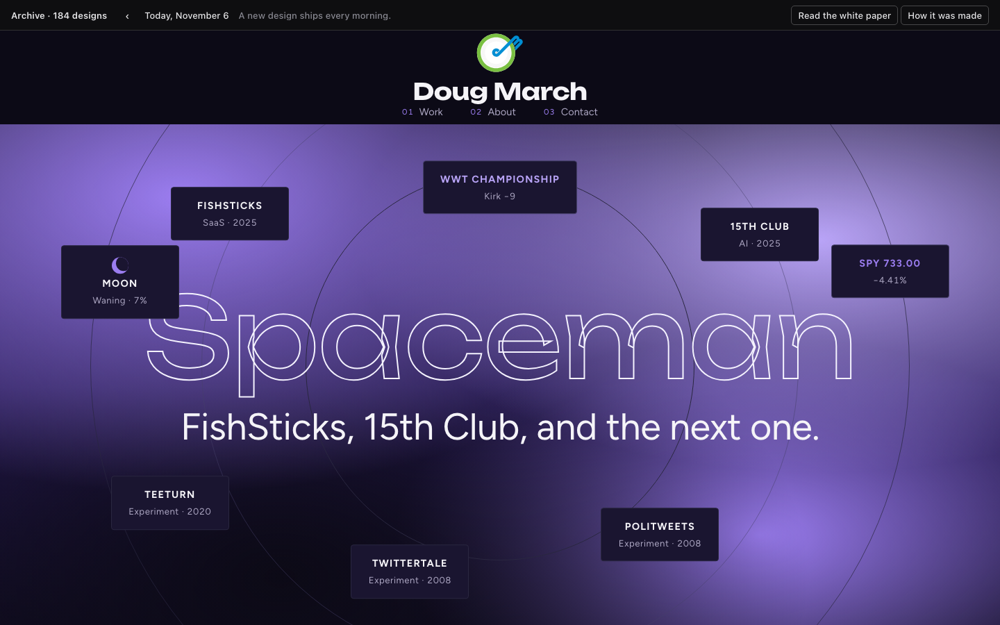
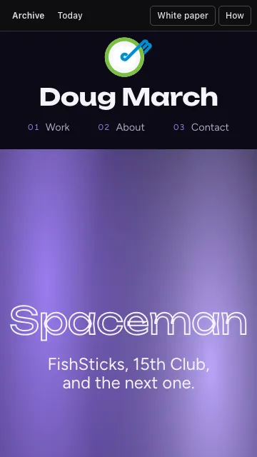

One look tonight: light and dark render the same.

<br>First fold at 360.

> Spaceman as a single violet word stroked in neon, floating at the center of a drifting nebula void while the products and the day's signals orbit it as satellites.

Live: https://dougmar.ch · [Archive entry](https://dougmar.ch/archive/2026-11-06)

Rate it (edit the YAML in a reply, ~2 min):
```yaml
grade: B        # A-D
worked: ""
didnt: ""
try: ""
```